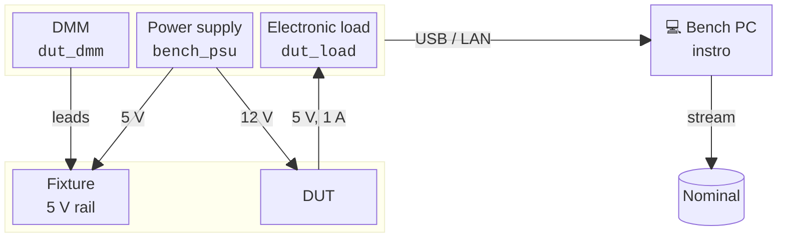

# Bench bring-up with instro

{.lead}
Check each instrument's data as you connect a bench

% TODO: introduction. Motivation: set up monitoring of a bench.

**Requirements:** a `default` [profile](https://nominal-io.github.io/nominal-client/guides/api-keys-setup/)
for the Nominal Python Client, and the packages the notebook imports, including
[instro](https://instro.nominal.io). [Running the notebooks](running.md) explains how to set them
up.

+++

## The bench

Bench 7 is a new test bench for a power-conversion board, the device under test (DUT). The DUT
converts 12 V to 5 V. Before the bench can test DUTs, you bring it up: you connect each instrument,
and make sure that its data is correct.

- The power supply's output 1 gives the DUT its 12 V input. Output 2 gives 5 V to the fixture,
  the board that holds the DUT.
- The DMM measures the fixture's 5 V rail.
- The electronic load draws 1 A from the DUT's 5 V output, and measures the voltage and current
  there.

Each instrument connects to the bench PC. On the PC, instro reads each instrument and streams its
data to Nominal. Each instrument box shows the instrument's instro name.



On a real bench, each instrument uses the instro driver for its model, with the instrument's VISA
address. For example, for a Keysight 34461A DMM on the network:

```python
from instro.dmm.drivers import Keysight34461A

dmm_hardware = Keysight34461A("TCPIP::192.168.1.20::INSTR")
```

instro has drivers for power supplies, DMMs, electronic loads, oscilloscopes and other instruments
from many vendors. The [instro documentation](https://instro.nominal.io) lists them. This notebook
uses instro's virtual drivers, which simulate the instruments, so it needs no hardware. Only the
driver changes on a real bench. The rest of the code stays the same.

The virtual instruments aren't wired together, so you set what each one measures:

```{code-cell} ipython3
from instro.dmm import MeasurementFunction
from instro.dmm.drivers import VirtualDMM
from instro.eload.drivers import VirtualELoad
from instro.psu.drivers import VirtualPSU

# The DUT draws 0.5 A from 12 V (24 ohm), and the fixture 0.5 A from 5 V (10 ohm).
psu_hardware = VirtualPSU(num_channels=2, load_resistance={1: 24.0, 2: 10.0})
# The DMM's leads are on the wrong output of the power supply, so it measures 12 V.
dmm_hardware = VirtualDMM({MeasurementFunction.DC_VOLTAGE: 12.0})
# The DUT's 5 V output, which drops a little as the load draws current.
eload_hardware = VirtualELoad(source_voltage=5.0, source_resistance=0.05)
```

## Connect the bench to Nominal

In Nominal, an asset represents a physical system: here, bench 7. Every instrument streams to the
asset's `bench` dataset. A run marks a period of time on the asset: here, the bring-up session. To
watch the data arrive during bring-up, open the run in Nominal with **Open in Nominal** on its card.

```{code-cell} ipython3
import pandas as pd
from nominal.core import NominalClient, set_display_options

# Show readable timestamps on Nominal's cards.
set_display_options(time_format="readable")

client = NominalClient.from_profile("default")
```

```{code-cell} ipython3
:tags: [remove-cell]

import warnings

# instro's Nominal publisher asks this nominal-client for its stream with a deprecated argument.
# The warnings don't affect the demo. The page does not show this cell.
warnings.filterwarnings(
    "ignore",
    message=r"(The `data_format` argument|implementation='rust_experimental') is deprecated",
    category=UserWarning,
)

# Start each execution with only its own data on the bench. The client cannot delete, so what
# earlier executions created is archived: runs and datasets. The `example` property matches
# only the bench this notebook created.
for old_asset in client.search_assets(properties={"example": "bench_bringup"}):
    for old_run in old_asset.list_runs():
        if not old_run.is_archived:
            old_run.archive()
    old_datasets = old_asset.list_datasets()
    old_asset.remove_data_scopes(names=[name for name, _ in old_datasets])
    for _, old_dataset in old_datasets:
        old_dataset.archive()
```

```{code-cell} ipython3
bench = client.get_or_create_asset_by_properties(
    {"bench_id": "bench-7", "example": "bench_bringup"}, name="Bench 7"
)
dataset = bench.get_or_create_dataset("bench", name="Bench 7 instruments")
# end=None leaves the run open until the session ends.
run = bench.create_run(
    "Bench 7 bring-up", start=pd.Timestamp.now(tz="UTC").floor("s"), end=None
)
run
```

## Connect the instruments

An instro instrument wraps a driver. `open()` connects to the instrument, and `start()` starts a
background daemon. The daemon reads the instrument at a fixed interval, and sends each reading to the
instrument's publishers. A `NominalCorePublisher` streams the readings to a Nominal dataset. instro
names each channel `<instrument name>.<channel>`. The instrument's card in the notebook shows its
latest readings.

The setup below has mistakes that are easy to make on a new bench. The check in the next section
finds them.

### The power supply

```{code-cell} ipython3
import time

from instro.lib import set_display_options as set_instro_display_options
from instro.lib.publishers import NominalCorePublisher
from instro.lib.types import BackgroundDaemonConfig
from instro.psu import InstroPSU

# Show readable timestamps on instro's cards.
set_instro_display_options(time_format="readable")

psu = InstroPSU(
    name="bench_psu",
    driver=psu_hardware,
    num_channels=2,
    # Stream every reading to the bench's dataset.
    publishers=[NominalCorePublisher(dataset=dataset)],
    # Read both outputs every 100 ms.
    background_config=BackgroundDaemonConfig(interval=0.1),
)
psu.open()
# Set each output's voltage and current limit, and turn the output on.
psu.apply(current_limit=1.0, voltage=12.0, enable=True, channel=1)
psu.apply(current_limit=1.0, voltage=5.0, enable=True, channel=2)
psu.start()
# The card shows the rate of each channel over the last 5 s.
time.sleep(5)
psu
```

The power supply measures the voltage, the current and the enable state of each output. The
channels that end in `.cmd` are the commands that the code sent, such as the 12 V setpoint
`ch1.voltage.cmd`. Each instrument also records its daemon's timing: `loop_time` is the time
between two reads, and `daemon_work_time` is the time that one read takes.

### The DMM

```{code-cell} ipython3
from instro.dmm import InstroDMM

dmm = InstroDMM(
    name="dmm",
    driver=dmm_hardware,
    publishers=[NominalCorePublisher(dataset=dataset)],
    background_config=BackgroundDaemonConfig(interval=0.1),
)
dmm.open()
dmm.set_measurement_function(MeasurementFunction.DC_VOLTAGE)
dmm.start()
time.sleep(5)
dmm
```

The DMM measures one value: the DC voltage.

### The electronic load

```{code-cell} ipython3
from instro.eload import InstroELoad, LoadMode

eload = InstroELoad(name="dut_load", driver=eload_hardware)
eload.open()
# Sink a constant 1 A.
eload.set_mode(LoadMode.CC)
eload.set_level(1.0)
eload.output_enable(True)
eload.start()
time.sleep(5)
eload
```

The electronic load measures the voltage and the current at its input.

## Check the bench's data

After bring-up, the bench runs a production test on each DUT. The test reads the bench's channels
from Nominal, not from the cards. Before the bench runs the test, make sure that each channel that
the test reads:

- gets to Nominal, under the name that the test uses
- has a value in the expected range
- arrives at the rate that the test needs

The test spec gives this information. It names each channel that the test reads, with the range of
values that the test expects. The test needs 10 Hz data. The lowest rate that the check accepts is
9.5 Hz, because the interval between reads varies a little.

```{code-cell} ipython3
SPEC = {
    "channels": {
        "bench_psu.ch1.voltage": (11.8, 12.2),
        "bench_psu.ch1.current": (0.45, 0.55),
        "bench_psu.ch2.voltage": (4.9, 5.1),
        "bench_psu.ch2.current": (0.45, 0.55),
        "dut_dmm.dc_voltage": (4.9, 5.1),
        "dut_load.ch1.voltage": (4.85, 5.0),
        "dut_load.ch1.current": (0.95, 1.05),
    },
    "min_rate_hz": 9.5,
}
```

`check()` gets the last 10 s of the bench's data from Nominal, and compares each channel with the
spec. It also reports each instrument that sends data but that the spec doesn't name, such as an
instrument with the wrong name.

```{code-cell} ipython3
from nominal.thirdparty.pandas import datasource_to_dataframe


def check(spec: dict, window_s: float = 10) -> pd.DataFrame:
    """Compare the last ``window_s`` seconds of the bench's data in Nominal with ``spec``."""
    end = pd.Timestamp.now(tz="UTC")
    start = end - pd.Timedelta(seconds=window_s)
    data = datasource_to_dataframe(dataset, start=start, end=end)
    data.index = pd.to_datetime(data.index)

    report = {}
    for channel, (low, high) in spec["channels"].items():
        values = data[channel].dropna() if channel in data else pd.Series()
        if values.empty:
            report[channel] = {"status": "no data"}
            continue
        latest = values.iloc[-1]
        # The rate from the median interval between samples. One sample gives no rate.
        intervals = values.index.diff().dropna()
        rate = 1 / intervals.median().total_seconds() if len(intervals) else 0
        if not low <= latest <= high:
            status = "out of range"
        elif rate < spec["min_rate_hz"]:
            status = "too slow"
        else:
            status = "ok"
        report[channel] = {"latest": latest, "rate (Hz)": rate, "status": status}

    # An instrument that sends data, but that the spec doesn't name.
    named = {channel.split(".")[0] for channel in spec["channels"]}
    sent = data.dropna(axis="columns", how="all")
    sending = {channel.split(".")[0] for channel in sent}
    for instrument in sorted(sending - named):
        report[f"{instrument}.*"] = {"status": "not in spec"}

    report = pd.DataFrame.from_dict(report, orient="index").round(3)
    # Show a value that a row doesn't have as an empty cell.
    return report.astype(object).fillna("")
```

```{code-cell} ipython3
check(SPEC)
```

The power supply's channels pass. The check finds two problems:

- The DMM's name is `dmm`, so its data arrives as `dmm.dc_voltage`, and `dut_dmm.dc_voltage` has
  no data.
- The electronic load's channels have no data. Its code gives it no publishers, so its card shows
  only the **in-memory buffer**, which feeds the card. Nothing goes to Nominal.

An instrument's name is fixed when you create it. To rename the DMM, close it and connect it again
as `dut_dmm`. You can add a publisher to a running instrument, so give the electronic load a Nominal
publisher without a restart.

```{code-cell} ipython3
dmm.close()
dmm = InstroDMM(
    name="dut_dmm",
    driver=dmm_hardware,
    publishers=[NominalCorePublisher(dataset=dataset)],
    background_config=BackgroundDaemonConfig(interval=0.1),
)
dmm.open()
dmm.set_measurement_function(MeasurementFunction.DC_VOLTAGE)
dmm.start()

eload.add_publisher(NominalCorePublisher(dataset=dataset))

# Wait until the window holds only data from after the changes.
time.sleep(15)
check(SPEC)
```

The DMM and the electronic load now send their data to Nominal. The check finds two more problems:

- `dut_dmm.dc_voltage` is 12 V, where the spec expects the 5 V rail. The DMM's leads are on the
  power supply's 12 V output.
- The electronic load's channels are too slow. Its code gives no `background_config`, so instro
  reads it at the default interval of 1 s. Its card shows **Background** as every 1 s.

Move the DMM's leads to the 5 V rail, and make the daemon read the electronic load every 100 ms:

```{code-cell} ipython3
# In the simulation, moving the leads changes the voltage that the virtual DMM reads.
dmm_hardware.stimulus[MeasurementFunction.DC_VOLTAGE] = 5.0
eload.background_interval = 0.1

time.sleep(15)
check(SPEC)
```

Every channel in the spec passes the check.

## End the session

```{code-cell} ipython3
# Closing an instrument stops its daemon and flushes its stream to Nominal.
for instrument in [psu, dmm, eload]:
    instrument.close()
# End the run.
run.update(end=pd.Timestamp.now(tz="UTC").ceil("s"))
bench
```

The bench's card shows its run and its dataset. Over the run, the DMM steps from 12 V to 5 V when
its leads move:

```{code-cell} ipython3
import matplotlib.pyplot as plt

plt.style.use("dark_background")

session = datasource_to_dataframe(
    dataset,
    channels=[dataset.get_channel("dut_dmm.dc_voltage")],
    start=run.start,
    end=run.end,
)
session.index = pd.to_datetime(session.index)
session.plot(style=".", figsize=(12, 3), ylabel="V", legend=False);
```
